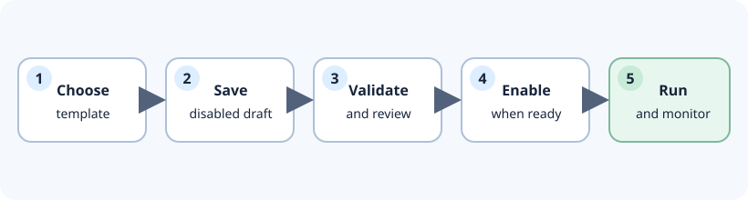
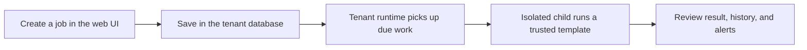
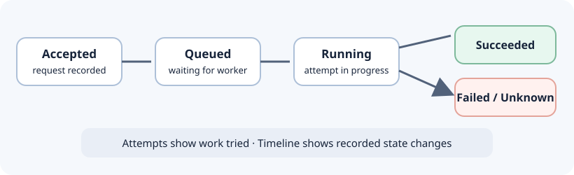

# WorkerDock

<h3 align="center">Your jobs have a home. Your team has the controls.</h3>

Create, schedule, run, and understand SQL Server and HTTP jobs from one self-hosted workspace.

<a href="docs/tutorials/run-in-memory.md">Explore the UI</a> · <a href="docs/index.md">Read the docs</a> · <a href="docs/how-to/deploy-production.md">Plan a deployment</a>

---

## From idea to answer

Pick a trusted template. Save a draft. Review its schedule and limits. Enable it when ready. Then follow every run from the dashboard.

| Build with confidence | Stay in control | See what happened |
| --- | --- | --- |
| Guided job creation for SQL Server and HTTP | Schedules, per-job capacity, timeouts, retries, and stop controls | Execution history, monitoring, alerts, and audit records |
| Versioned trusted templates and validated forms | Separate tenant deployments and optional role-protected management | Safe diagnostics and retention tools |

## One tenant, one clear path for work

Each tenant has its own web app, SQL Server database, and Windows runtime service. The optional Control Center links to independent tenants and shows their health. No external message broker is required. [See the deployment map](docs/reference/architecture.md#deployment-map).

## Every run tells a story

When a job finishes, its attempts and timeline help your team understand the result. When the outcome is uncertain, WorkerDock records that state for review instead of presenting a false success. [Explore execution guarantees](docs/reference/execution-guarantees.md).

## Choose your first step

| I want to… | Start here | What you get |
| --- | --- | --- |
| Look around without setting up SQL Server | [Run the memory demo](docs/tutorials/run-in-memory.md) | A disposable local UI. It cannot execute jobs. |
| Run real jobs on my machine | [Set up SQL Server](docs/how-to/setup-sql-server.md), then [follow the SQL tutorial](docs/tutorials/run-with-sql-server.md) | A tenant database, web UI, and runtime service. |
| Install an instance | [Follow the production guide](docs/how-to/deploy-production.md) | Packaging and deployment steps for Windows. |
| Change the code | [Start with the contributor guide](CONTRIBUTING.md) | A code map and checks, from fast tests to SQL tests. |

The [documentation home](docs/index.md) explains the terms and points to one guide for each job.

## Built for teams that need the details

- **Know what ran:** inspect jobs, attempts, monitoring, and audit history.
- **Keep work bounded:** set schedule policies, job capacity, host capacity, and timeouts.
- **Keep tenants independent:** each tenant owns its database and runtime; the optional Control Center is a directory, not a shared execution engine.
- **Extend deliberately:** add trusted, versioned templates in code. The browser does not upload executable packages.

WorkerDock is in **release validation**. The memory demo is for exploration, and portable checks do not prove a live Windows, IIS, SQL Server, or identity-provider deployment. Production secret-vault adapters are deployment-specific. Review the [release checklist](docs/validation/release-checklist.md) and [recorded evidence](docs/validation/release-evidence.md) before production use.

MIT licensed. See [LICENSE](LICENSE), [SECURITY.md](SECURITY.md), and [CONTRIBUTING.md](CONTRIBUTING.md).
