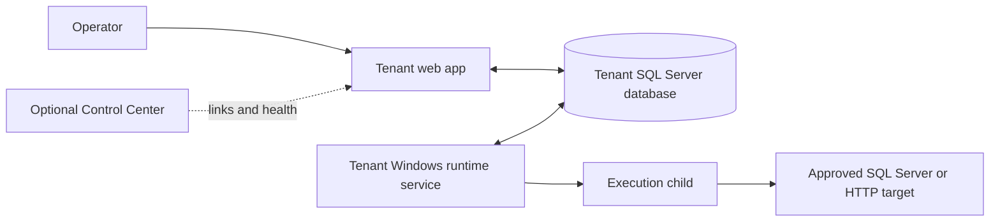

# WorkerDock

WorkerDock is a self-hosted platform for defining, scheduling, executing, and monitoring SQL Server and HTTP jobs. Each tenant has a web application, a SQL Server database, and one Windows runtime service. The optional Control Center provides a directory and health view for independently deployed tenants.

## Capabilities

| Area | What WorkerDock provides |
| --- | --- |
| Job management | Guided creation, disabled drafts, versioned trusted templates, and explicit activation. |
| Execution | Manual and scheduled runs, per-job and host capacity limits, timeouts, retries, and stop controls. |
| Operations | Execution history, monitoring, alerts, audit records, and retention settings. |
| Tenant boundaries | A separate database and runtime service per tenant; the Control Center does not execute tenant jobs. |

## Architecture

The runtime starts bounded child processes to run trusted templates. It reads queued work directly from the tenant database; no external message broker is required. See [architecture](docs/reference/architecture.md) and [execution guarantees](docs/reference/execution-guarantees.md) for details.

## Get started

| Goal | Guide |
| --- | --- |
| Explore the UI without SQL Server | [Run in memory](docs/tutorials/run-in-memory.md). Data is temporary and jobs do not execute. |
| Run jobs locally with SQL Server | [Set up SQL Server](docs/how-to/setup-sql-server.md), then [run the tenant and runtime](docs/tutorials/run-with-sql-server.md). |
| Prepare a Windows deployment | [Deployment guide](docs/how-to/deploy-production.md) and [tenant configuration](docs/how-to/configure-tenants.md). |
| Work on the code | [Contributor guide](CONTRIBUTING.md) and [development checks](docs/validation/development-checks.md). |

The [documentation index](docs/index.md) links to task guides and technical references. The tenant SQL schema is defined by the checksummed manifest in [database/tenant](database/tenant); `current-state.sql` is for a new, empty database only.

## Production deployment

WorkerDock supports production deployments on Windows with SQL Server 2022 or newer. Install a deployment-specific `ISecretVault` adapter in each process that resolves secrets; the repository does not include one. Follow the [deployment guide](docs/how-to/deploy-production.md) and [release checklist](docs/validation/release-checklist.md) for environment-specific setup and verification. Record candidate results in [release evidence](docs/validation/release-evidence.md).

WorkerDock uses the [MIT License](LICENSE). See [SECURITY.md](SECURITY.md) for security reporting.
