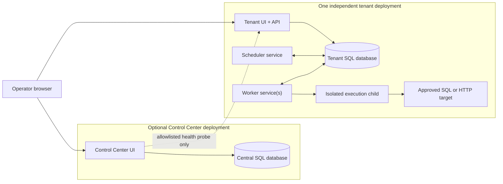

# Architecture

WorkerDock is a self-hosted job platform. Its deployment boundary is a tenant: each tenant has an IIS application, SQL Server database, scheduler service, and one or more worker services. Tenants may share infrastructure, but shared Windows-host and SQL administrators remain trusted across tenants. A separate Control Center database stores tenant directory and health observations; it does not provision tenants, access their databases, or proxy their management sessions.

## Deployment map

The Control Center holds links and health results. A browser opens the tenant
directly, where that tenant's own sign-in and role policy apply. Quartz's two
table sets and WorkerDock's business records live inside the tenant database;
the execution child resolves secrets through that tenant's configured vault
identity.

## Components

- **Tenant web application (IIS):** serves the dashboard and management/read APIs, authentication, configuration, and audit transactions. It does not execute handlers.
- **Scheduler Windows service:** owns schedule/control Quartz work, projects durable WorkerDock intents into Quartz, and runs bounded operational maintenance.
- **Worker Windows service:** joins the execution Quartz cluster, supervises attempts, and launches isolated child processes. A job or concurrency edit does not install a service.
- **Execution child:** performs one attempt or diagnostic run, resolves configured secrets, and invokes a built-in or installed trusted template.
- **Control Center:** maintains its own registry and probes an allowlisted tenant health endpoint using a minimal health credential.
- **Database migrator:** applies versioned SQL scripts using a migration identity. Runtime startup does not create schema.

Each tenant database contains WorkerDock-owned objects in `[workerdock]` and two Quartz table sets: `WDS_QRTZ_` for schedule/control and `WDE_QRTZ_` for execution. Quartz APIs own Quartz persistence lifecycle. WorkerDock application tables contain job configuration, execution history, audit, projection intents, and policies. The web app writes WorkerDock commands and audit records; scheduler and worker services interact with Quartz stores.

## Scheduling and execution

WorkerDock commits business changes, audit records, and durable projection intents together. A publisher later applies intents through Quartz APIs using deterministic keys and reconciliation. SQL transactions do not make the application write and Quartz publication atomic, so pending and failed projection states are operationally visible and reconciled.

Quartz selects durable dispatch triggers and invokes a generic execution wrapper. The wrapper holds its Quartz execution slot until the child process exits and its outcome is handled. The worker supervises children and rejects stale completions using attempt ownership fencing. Operators stop work through durable controls; stopping a service may still terminate a child after its configured drain period.

Delivery is at least once. A process crash or uncertain acknowledgement can lead to retry after external work has started. WorkerDock cannot guarantee exactly-once external effects. Retries depend on configured policy and idempotency; uncertain outcomes may require operator review. Scheduled occurrences and manual request retries have deduplication identities, but these do not make downstream side effects exactly once.

Schedules use five-field cron semantics and an explicit time zone. DST gaps and repeated local times follow the persisted WorkerDock policy. Missed-work behavior is configurable. See the schedule UI and the implementation's schedule policy tests for the exact deployed behavior; do not assume a third-party cron dialect without checking compatibility.

## Authentication and secrets

OIDC/Entra authentication is optional in configuration. When configured, readers need an authenticated session and management actions may additionally require the configured role. When OIDC settings are absent, **Anonymous mode allows both read and management access**; do not expose an instance in this mode to an untrusted network.

Connection profiles store nonsecret settings and credential references, not passwords or full connection strings. Secret values resolve at execution time through `ISecretVault`. The repository includes an environment-backed adapter for development; production vault adapters are not supplied and must be installed in the relevant service composition roots before secret-backed production work. The Control Center currently refuses Production startup without its adapter. Its health credential is not a tenant management credential. See [secret integration](secrets.md) and [deployment](how-to/deploy-production.md).

## Capacity and limits

The design's initial validation target is up to 10 independent tenants, 100 configured jobs per tenant, and 10 concurrent executions per tenant. These are targets, not guaranteed capacity or fixed product ceilings. Actual throughput depends on job duration, process startup, SQL latency, and host resources. Publish measured results with hardware and workload details before making capacity claims.

Finite execution deadlines and configured service drain periods bound normal work, but an infinite-timeout handler can run indefinitely. External side effects may have occurred when a worker loses contact with a child. There is no strict global priority guarantee. Worker availability also depends on SQL Server; the central directory is not required for tenants to operate or be accessed directly.

## Observability and retention

WorkerDock records execution events, safe logs, audit records, service health, alerts, and bounded metric aggregates in SQL Server. Alerts and the Control Center cannot report through a prolonged database, scheduler, or network outage. Operators should also monitor Windows services, host health, SQL Server, clock synchronization, disk space, archive health, and worker catalog compatibility independently.

Retention is bounded and preserves active work and replay dependencies. Archive-before-delete is opt-in; archives are integrity-checked exports, not database backups or proof against an administrator changing both archive and manifest. See [retention and archive operations](retention-archive.md).
