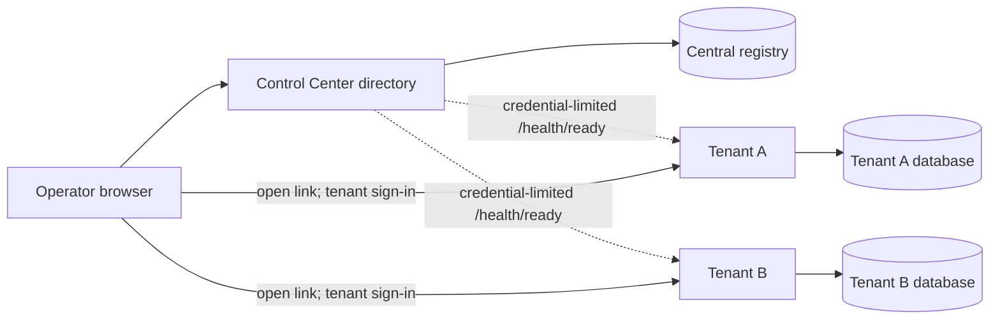

# Control Center

The Control Center is an optional, separate ASP.NET Core application with its own React entry point and central SQL Server database. It stores tenant links, health observations and its own append-only audit events. It does not create tenants, change tenant configuration, or read tenant jobs. Each link opens the tenant's dashboard directly; the tenant's own authentication and authorization still apply.



The dotted paths are advisory health checks. The solid browser paths are
direct tenant visits; central membership never grants tenant access. Each
tenant uses its own database, runtime processes and vault identity.

## Run locally

Follow the [memory-only tutorial](tutorials/run-in-memory.md) for a disposable Control Center UI or the [SQL Server tutorial](tutorials/run-with-sql-server.md) for a tenant with persistent execution. The local tenant URLs in those tutorials use a non-443 port, so they cannot serve as Control Center health-probe targets. A real health probe needs an HTTPS tenant URL on port 443, an allowlisted host, an expected instance ID and a secret reference resolved by the Center's vault identity.

## SQL Server setup

Use SQL Server 2022+ with database compatibility level 160. Create a dedicated, empty central database and a stable central instance GUID. Apply the central migration with a separate deployment-only migrator identity that can create the schema and role:

```powershell
$env:WORKERDOCK_INSTANCE_ID='<stable-central-instance-guid>'
$env:WORKERDOCK_SQL='<central-migrator-connection-string>'
dotnet run --project src/WorkerDock.DatabaseMigrator -- apply central 0001_registry
```

Add the Central application database identity to the `WorkerDockCentralRuntime` database role. The migration grants this role access only to `[workerdock].CentralSettings`, `[workerdock].TenantRegistrations`, `[workerdock].TenantHealthObservations` and append-only `[workerdock].AuditEvents`. Keep DDL permissions with the migrator. Preserve the same instance GUID in the Central application configuration; each connection checks it against `CentralSettings`.

Example Central configuration (supply values through protected deployment configuration):

```powershell
$env:Central__Adapter='Sql'
$env:Central__InstanceId='<same-stable-central-instance-guid>'
$env:Central__ConnectionString='<central-runtime-connection-string>'
$env:Central__Health__AllowedHosts__0='tenant-a.example.com'
$env:Central__Health__AllowedHosts__1='tenant-b.example.com'
```

`Central__Health__AllowedHosts` is mandatory and must list the approved tenant hostnames; an empty allowlist prevents startup. Internal/private destinations require explicit `Central__Health__AllowedPrivateCidrs` ranges as well. Probes require HTTPS on port 443, resolve and validate all destination addresses, reject redirects, proxies and cookies, and request only the fixed `/health/ready` endpoint. The endpoint must be configured on each tenant with its own health credential reference, and its returned `InstanceId` must match the registered expected ID. Health is advisory: a successful observation becomes `Stale` after two minutes. Refresh is authenticated when Entra is configured, available anonymously only when authentication is disabled, rate-limited and protected against CSRF.

The development environment vault is disabled unless `WORKERDOCK_DEVELOPMENT_VAULT=1`; it resolves only explicit logical-reference-to-environment-variable mappings. Production startup requires replacing the development registration in `Program.cs` with the organization's `ISecretVault` adapter. Bind it to a central-only identity and restrict its reference allowlist to health credentials. Tenant databases and credentials must not be accessible to this identity.

## Authentication and roles

The Control Center uses its own Entra app registration, cookie prefix, data-protection discriminator and database identity. Configure its `Access__Authority`, `Access__ClientId` and protected `Access__ClientSecretReference` as described in [authentication.md](authentication.md). Any authenticated user accepted by that audience may read the directory and refresh health. If `Access__RequiredManagementRole` is configured, only its configured role claim may register, edit or remove links; if omitted, any authenticated user may manage. If no authentication configuration is supplied, access is anonymous, including management. Restrict anonymous deployments at the network boundary. The same policies protect the management API, not just the React controls.

Registration stores only URL, expected instance ID and logical secret reference. Audit records include actor, action, entity, timestamp and correlation ID, with sanitized display metadata; no health credential values are written to SQL, logs or responses. Removal deletes a link and cached observation only.

## Migrations and rollback

Migration source, rollback and manifest are in [`database/central`](../database/central). The migrator validates both SHA-256 checksums, requires SQL Server 2022/compatibility 160, uses a SQL application lock and records the central instance identity. The paired rollback refuses to discard registered tenants or audit events. Back up and deliberately export/remove those records before a disposable rollback. Do not run a tenant migration against the central database or share the central database with tenant deployments.

There is no dedicated central Windows service. Host the Control Center web application separately (for example, as its own IIS application); tenant schedulers and worker services continue to run independently if the Control Center is unavailable.
