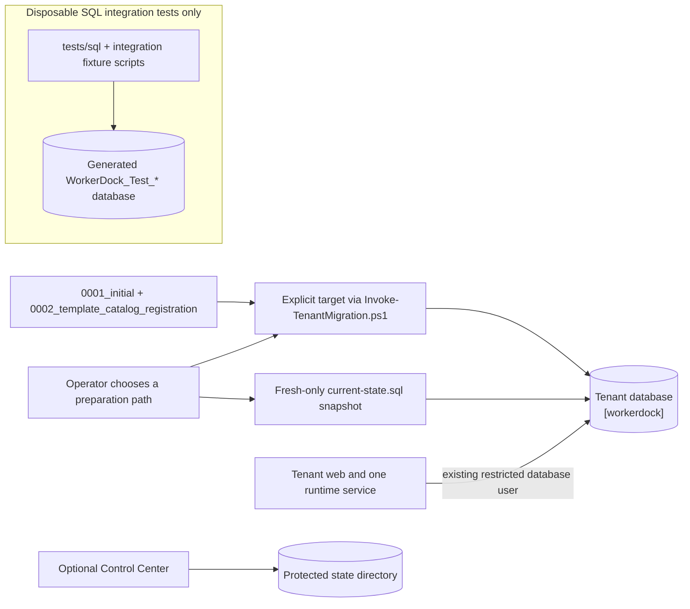

# Set up SQL Server

WorkerDock tenant databases require SQL Server 2022 or newer with database compatibility level 160. Provision one separate database for each tenant. The Control Center uses protected files and has no SQL Server requirement.

## Runtime and test databases



For a new tenant database, apply the checksummed manifest through
`0002_template_catalog_registration` using `scripts/Invoke-TenantMigration.ps1`, or apply
`database/tenant/current-state.sql` to a fresh empty database. Both create the
same final schema. Migration `0002` lets the Web host promote the two built-in
catalog placeholders to their trusted descriptors. The snapshot already
includes that state. The baseline and snapshot do not convert older tenant
schemas. The `tests/sql` scripts create only
fixture objects in generated disposable databases; never apply them to a
runtime tenant. SQL behavior remains unverified until run against a disposable
SQL Server 2022+ instance.

Do not execute `database/tenant/0001_initial.up.sql` directly in SSMS: it is a
parameterized migration source, and the migration runner supplies `@InstanceId`.
For manual setup, use the rendered `current-state.sql` snapshot described below.

This is a fresh-install-only baseline and does not convert an existing tenant
database.
The in-memory tutorial needs none of these SQL objects.

### Fresh database snapshot

Use `database/tenant/current-state.sql` only for a newly created, empty tenant
database at compatibility level 160 or later. The selected runtime database
user must already exist in the target database. The snapshot validates and
grants that existing user; it does not create users, logins, or roles. Generate
one tenant GUID and replace every `__WORKERDOCK_INSTANCE_ID__` and
`__WORKERDOCK_RUNTIME_PRINCIPAL__` token in a working copy with the GUID and
database-user name. Replace every occurrence of each token.

In SSMS, enable **Query > SQLCMD mode** before running the complete rendered
file against the selected database. Keep the leading `:ON ERROR EXIT`
directive: it stops execution on the first error, including a preflight
failure, so SSMS cannot continue into later `GO` batches. Do not execute
selected batches or remove the directive. Run on a dedicated connection with
no open transaction; the file commits its setup transaction only after all
batches succeed. After an error, close that connection to roll back any
uncommitted setup changes. Its history rows are
an equivalent satisfied state baseline, not a record that each earlier
migration script ran. The snapshot represents the final state only and cannot
upgrade an existing database. Live SQL parity remains unverified.

## Provision a tenant database

As a SQL Server administrator, create an empty database and set its compatibility level:

```sql
CREATE DATABASE [WorkerDockTenant];
ALTER DATABASE [WorkerDockTenant] SET COMPATIBILITY_LEVEL = 160;
```

Provision a separate migration identity with permission to create schemas,
tables, procedures and grant permissions in this dedicated
database. A temporary `db_owner` membership is one way to supply these
installation rights; remove it after migration. Provision a separate long-lived
application identity as an existing database user in this target database.
The application identity must not be a database owner or receive DDL rights.
Use your organization's approved SQL or Windows identity process to create and
map it before setup; setup scripts only validate and grant the selected user.

From a PowerShell session at the repository root, apply migrations with an explicit target from
`database/tenant/manifest.json`. Build or publish the Web application so the
assembly directory contains `WorkerDock.Web.dll`, its dependency manifest, and
`WorkerDock.Infrastructure.dll`; for example, use `dotnet publish` with your
selected configuration. Supply the existing runtime database user as
`-RuntimePrincipal`, choose `-InitialSetup` to generate a GUID on first apply,
and use the separate deployment migration credential:

The PowerShell host must run on .NET 10 or later; PowerShell 7 alone is not
sufficient when its host is bound to an earlier .NET runtime. Check
`[System.Environment]::Version` in the session before invoking the script.

```powershell
$credential = Get-Credential '<TENANT_MIGRATION_LOGIN>'
$assemblyDirectory = (Resolve-Path 'src/WorkerDock.Web/bin/Release/net10.0').Path
& scripts/Invoke-TenantMigration.ps1 `
  -Action Apply `
  -SqlHost '<SQL_SERVER_FQDN>' -Port 1433 -Database '<TENANT_DATABASE>' `
  -Credential $credential -RuntimePrincipal '<TENANT_DATABASE_USER>' -InitialSetup `
  -TargetMigration '0002_template_catalog_registration' `
  -ScriptsRoot (Resolve-Path 'database').Path `
  -AssemblyDirectory $assemblyDirectory
```

The manifest contains the `0001_initial` baseline and `0002_template_catalog_registration` patch. The script verifies every checksum, schema history, server version, compatibility level, existing runtime database user, and stable tenant instance ID. Save the GUID printed after a successful
initial setup and use it for `Tenant:InstanceId` in Web and runtime
configuration. For an already initialized tenant, supply that same GUID with
`-InstanceId` instead of `-InitialSetup`. Keep the migration identity separate
from the long-lived runtime identity and remove its temporary DDL grants after
migration.

`WORKERDOCK_DEVELOPMENT_VAULT` and its explicit secret map are for local Development only. Production must follow the organization's approved protected credential process for the migration identity. The script prompts through a PowerShell credential object; do not place credentials in command lines, shell history or source control.

There are no tenant schema upgrades. A future schema change needs a separately reviewed upgrade design before deployment to any existing tenant database.

The migration validates and grants the existing `-RuntimePrincipal` directly.
It does not create a database user, role, or server login. Use the same
database user in the tenant SQL connection configuration.

Configure the tenant web and one runtime service with `Tenant:Adapter=Sql`, the same `Tenant:InstanceId`, and `Tenant:Sql:Host`, `Port`, `Database`, `User` and `PasswordReference`. Use the restricted application identity and an explicitly mapped logical reference. SQL connections require encryption and valid server certificate verification; install the issuing CA/server certificate in the host trust store. Do not enable trust-server-certificate bypasses. The deployment tooling configures services and hosts; SQL setup and migration are an explicit operator step. Restart affected processes after rotating a vault password so new connections use it.

## Optional current Control Center

The current center uses `Central:InstanceId` and an absolute
`Central:Storage:DataDirectory` outside release and web directories. Protect
the directory so only the center IIS application-pool identity and
administrators can modify it, and keep it outside web serving. No central SQL
database, migration, SQL identity, or SQL connection string is required. See
[Control Center setup](configure-control-center.md) for persistent storage and
health-probe configuration. Tenant SQL setup above remains required for each
tenant.

## Roll back a database

Take and verify a backup first. The `0001_initial` rollback is guarded against discarding populated state. Stop the web and runtime services before rollback. For a truly empty disposable tenant database, run:

```powershell
$credential = Get-Credential '<TENANT_MIGRATION_LOGIN>'
& scripts/Invoke-TenantMigration.ps1 `
  -Action Rollback -SqlHost '<SQL_SERVER_FQDN>' -Port 1433 `
  -Database '<TENANT_DATABASE>' -Credential $credential `
  -RuntimePrincipal '<TENANT_DATABASE_USER>' -InstanceId '<same-tenant-guid>' `
  -TargetMigration '0001_initial' `
  -ScriptsRoot (Resolve-Path 'database').Path `
  -AssemblyDirectory (Resolve-Path 'src/WorkerDock.Web/bin/Release/net10.0').Path
```

There are no preceding migration IDs. For a populated database, restore a backup or follow a separately reviewed recovery plan; do not bypass the rollback guard. The Control Center has no SQL rollback because it stores its state in protected files.

## SQL integration tests

Only run SQL integration tests against an isolated, disposable SQL Server instance. The `WORKERDOCK_TEST_SQL` identity needs permission to create and drop databases in `master`; fixtures generate `WorkerDock_Test_<32 hex digits>`, set compatibility 160, and drop only that generated database. SQL target-template tests use a distinct restricted login in `WORKERDOCK_TEST_SQL_TARGET_RUNTIME`. All logins must point to the same disposable server. Never use a production server or a database that contains data to preserve.

```powershell
$env:WORKERDOCK_TEST_SQL='<disposable-server-provisioner-connection-string>'
$env:WORKERDOCK_TEST_SQL_RUNTIME='<same-server-restricted-runtime-login>'
$env:WORKERDOCK_TEST_SQL_TARGET_RUNTIME='<same-server-restricted-target-login>'
dotnet test tests/WorkerDock.IntegrationTests -c Release
```

The fixtures own their generated databases and test objects. Their test-only SQL lives under `tests/sql` and `tests/WorkerDock.IntegrationTests/Sql`; it is not part of runtime provisioning. Missing SQL configuration causes the SQL fixtures to report `SQL_TEST_BLOCKED`. Record actual runs in the [release evidence](../validation/release-evidence.md).

See [database object reference](../reference/database-objects.md), [Control Center setup](configure-control-center.md), and [deployment model](../reference/deployment-model.md) for object inventories and runtime design details.
