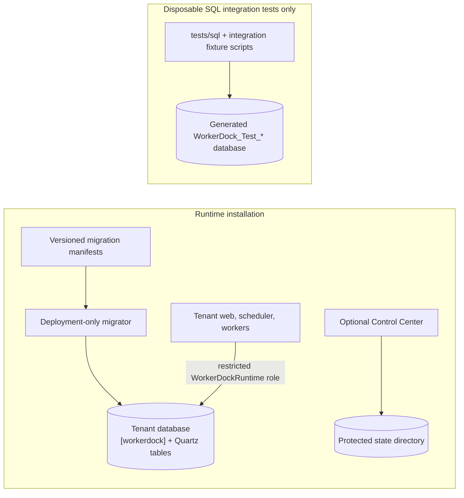

# Set up SQL Server

WorkerDock tenant databases require SQL Server 2022 or newer with database compatibility level 160. Provision one separate database for each tenant. The Control Center uses protected files and has no SQL Server requirement.

## Runtime and test databases



The tenant runtime manifest under `database/tenant` creates application objects
and includes paired rollback scripts. It is the only production migration
source. The `tests/sql` scripts create only fixture objects in generated
disposable databases; never apply them to a runtime tenant. Quartz's attributed
upstream source is retained for provenance and is not installed independently.
The in-memory tutorial needs none of these SQL objects.

## Provision a tenant database

As a SQL Server administrator, create an empty database and set its compatibility level:

```sql
CREATE DATABASE [WorkerDockTenant];
ALTER DATABASE [WorkerDockTenant] SET COMPATIBILITY_LEVEL = 160;
```

Provision a deployment migrator identity with permission to create schemas,
tables, procedures and roles and to grant permissions in this dedicated
database. A temporary `db_owner` membership is one way to supply these
installation rights; remove it after migration. Provision a separate long-lived
application identity as an existing database user. The application identity
must not be a database owner or receive DDL rights. Use your organization's
approved SQL or Windows identity process; deployment scripts do not create
server logins or database users.

Apply the complete current tenant migration chain from the repository root. Supply a newly generated, stable GUID for this tenant and a protected migrator configuration file based on `deploy/config/migrator.example.json`. Its `Migrator:Sql` fields are `Host`, `Port`, `Database`, `User` and `PasswordReference`. Map the logical password reference through the deployment vault; never put the password or a connection string in the file. Keep the file ACL restricted to the deployment identity:

```powershell
$env:WORKERDOCK_INSTANCE_ID='<stable-tenant-guid>'
$env:WORKERDOCK_DEVELOPMENT_VAULT='1'
$env:WORKERDOCK_DEVELOPMENT_SECRET_MAP='{"tenant.migrator.sql.password":"TENANT_MIGRATOR_PASSWORD"}'
$env:TENANT_MIGRATOR_PASSWORD='<retrieve-from-protected-local-secret-store>'
$env:Migrator__Sql__Host='<SQL_SERVER_FQDN>'
$env:Migrator__Sql__Port='1433'
$env:Migrator__Sql__Database='<TENANT_DATABASE>'
$env:Migrator__Sql__User='<TENANT_MIGRATOR_LOGIN>'
$env:Migrator__Sql__PasswordReference='tenant.migrator.sql.password'
dotnet run --project src/WorkerDock.DatabaseMigrator -- apply tenant 0008_retention
```

`WORKERDOCK_DEVELOPMENT_VAULT` and its explicit secret map are for local Development only. Production must register the organization's `ISecretVault` adapter and resolve `PasswordReference` under the deployment migrator identity. Do not place credentials in command lines, shell history or source control.

The runner applies every earlier migration in `database/tenant/manifest.json`, verifies both script checksums, checks server version and compatibility level, records migration history, and binds the database to the supplied instance ID. For a later release, apply its newest manifest migration ID. The migrator needs DDL rights only during migration.

After migration, ensure the tenant application identity is mapped to a
database user, then add that principal to the runtime role. From the repository
root, connect as an administrator with Windows authentication and replace the
server and database principal placeholders:

```powershell
sqlcmd -S '<SQL_SERVER>' -d WorkerDockTenant -E -b `
  -v TenantRuntimePrincipal="<TENANT_DB_USER>" `
  -i .\deploy\permissions.sql
```

`deploy/permissions.sql` adds a supplied tenant principal to `WorkerDockRuntime`; the tenant migration defines the grants. The tenant role contains the application's required data access, including DML for both Quartz stores. It does not grant schema changes. To remove an explicit role membership:

```powershell
sqlcmd -S '<SQL_SERVER>' -d WorkerDockTenant -E -b `
  -v TenantRuntimePrincipal="<TENANT_DB_USER>" `
  -i .\deploy\permissions.rollback.sql
```

Configure each tenant web, scheduler and worker host with `Tenant:Adapter=Sql`, the same `Tenant:InstanceId`, and `Tenant:Sql:Host`, `Port`, `Database`, `User` and `PasswordReference`. Use the restricted application identity and an explicitly mapped logical reference. SQL connections require encryption and valid server certificate verification; install the issuing CA/server certificate in the host trust store. Do not enable trust-server-certificate bypasses. The deployment package installer configures services and IIS; it does not create databases or run migrations. Restart affected processes after rotating a vault password so new connections use it.

## Optional current Control Center

The current center uses `Central:InstanceId` and an absolute
`Central:Storage:DataDirectory` outside release and web directories. Protect
the directory so only the center IIS application-pool identity and
administrators can modify it, and keep it outside web serving. No central SQL
database, migration, SQL identity, or SQL connection string is required. See
[Control Center setup](configure-control-center.md) for persistent storage and
health-probe configuration. Tenant SQL setup above remains required for each
tenant.

## Roll back a database

Take and verify a backup first. Rollbacks run one migration at a time and are guarded against discarding populated state. Stop all web, scheduler, worker, and publisher processes before rollback. For a truly empty disposable tenant database, remove the runtime membership, then run:

```powershell
$env:WORKERDOCK_INSTANCE_ID='<same-tenant-guid>'
dotnet run --project src/WorkerDock.DatabaseMigrator -- rollback tenant 0008_retention
```

Continue with preceding IDs only when their down scripts' empty-state requirements are satisfied. For a populated database, restore a backup or perform a separately planned data migration; do not bypass a rollback guard. The Control Center has no SQL rollback because it stores its state in protected files.

## SQL integration tests

Only run SQL integration tests against an isolated, disposable SQL Server instance. The `WORKERDOCK_TEST_SQL` identity needs permission to create and drop databases in `master`; fixtures generate `WorkerDock_Test_<32 hex digits>`, set compatibility 160, and drop only that generated database. Quartz process tests additionally require a distinct restricted SQL login in `WORKERDOCK_TEST_SQL_RUNTIME`. SQL target-template tests use a third distinct restricted login in `WORKERDOCK_TEST_SQL_TARGET_RUNTIME`. All logins must point to the same disposable server. Never use a production server or a database that contains data to preserve.

```powershell
$env:WORKERDOCK_TEST_SQL='<disposable-server-provisioner-connection-string>'
$env:WORKERDOCK_TEST_SQL_RUNTIME='<same-server-restricted-runtime-login>'
$env:WORKERDOCK_TEST_SQL_TARGET_RUNTIME='<same-server-restricted-target-login>'
dotnet test tests/WorkerDock.IntegrationTests -c Release
```

The fixtures own their generated databases and test objects. Their test-only SQL lives under `tests/sql` and `tests/WorkerDock.IntegrationTests/Sql`; it is not part of runtime provisioning. Missing SQL configuration causes the SQL fixtures to report `SQL_TEST_BLOCKED`. Record actual runs in the [release evidence](../validation/release-evidence.md).

See [database object reference](../reference/database-objects.md), [Control Center setup](configure-control-center.md), and [Quartz integration](../reference/quartz-integration.md) for object inventories and design details.
