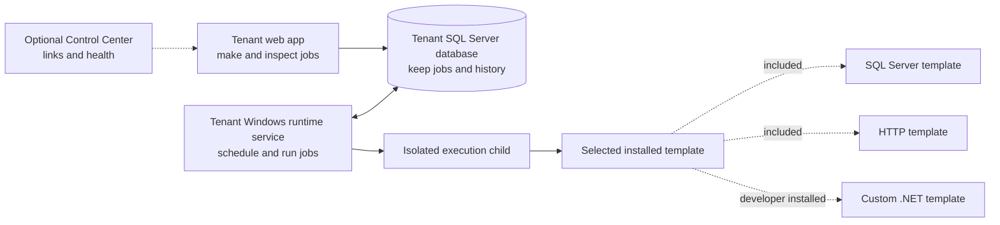

# WorkerDock docs: start here

New to WorkerDock? Follow the first row that matches what you want. You do not need to read every page.

| Your goal | Follow this path | You will know it worked when… |
| --- | --- | --- |
| See the app | [Run the memory demo](tutorials/run-in-memory.md) | The Jobs page opens at `https://localhost:5001/`. |
| Run a real job | [Prepare SQL Server](how-to/setup-sql-server.md) → [run with SQL Server](tutorials/run-with-sql-server.md) | The tenant UI and runtime service are running. |
| Add your own job type | [Add a custom template](how-to/add-custom-template.md) | Your reviewed template appears in the catalog after a compatible deployment. |
| Change code | [Start with the contributor guide](../CONTRIBUTING.md) → [run developer checks](validation/development-checks.md) | The checks for your changed area pass. |
| Install WorkerDock | [Deploy to production](how-to/deploy-production.md) → [configure tenants](how-to/configure-tenants.md) | The deployment checks and live release gates pass. |

## How the pieces fit

A **tenant** is one independent WorkerDock installation. Its **web app** is where people manage jobs. Its **runtime service** does the scheduled work using the template version selected by each job. SQL Server and HTTP templates come with WorkerDock; developers can install reviewed custom .NET templates for other workflows. The tenant **database** keeps jobs and history. The optional **Control Center** lists tenants; it does not run their jobs. The memory demo starts only disposable web apps, so it cannot prove real execution.

## Learn one task at a time

| To do this | Read this |
| --- | --- |
| Create, edit, run, or archive a job | [Manage jobs](how-to/manage-jobs.md) |
| Add a template as a developer | [Add a custom template](how-to/add-custom-template.md) |
| Set up sign-in and roles | [Configure authentication](how-to/configure-authentication.md) |
| Connect tenants to the Control Center | [Configure the Control Center](how-to/configure-control-center.md) |
| Keep or export old records | [Manage retention and archives](how-to/manage-retention-and-archives.md) |
| Update or recover an installation | [Upgrade or restore](how-to/upgrade-and-restore.md) |
| Find why something failed | [Troubleshoot](how-to/troubleshooting.md) |

## Look up exact details

- **Setup:** [configuration keys](reference/configuration.md), [deployment model](reference/deployment-model.md), [database migrations](reference/database-migrations.md), and [database objects](reference/database-objects.md).
- **Jobs and templates:** [built-in SQL Server](reference/sql-template.md), [built-in HTTP](reference/http-template.md), [custom template authoring](reference/template-authoring.md), [scheduling](reference/scheduling.md), and [execution guarantees](reference/execution-guarantees.md).
- **Operations:** [monitoring](reference/monitoring.md), [observability](reference/observability.md), [alerts](reference/alerts.md), [outbound policy](reference/outbound-policy.md), and [secrets](reference/secrets.md).
- **Architecture and licenses:** [architecture](reference/architecture.md) and the generated [.NET license inventory](reference/third-party-notices-dotnet.md).

## Before a release

Use the [release checklist](validation/release-checklist.md), [recorded evidence](validation/release-evidence.md), [fault matrix](validation/fault-matrix.md), and [workload procedure](validation/workload-results.md). The [developer checks](validation/development-checks.md) explain which checks run without SQL Server and which need a disposable SQL Server.
