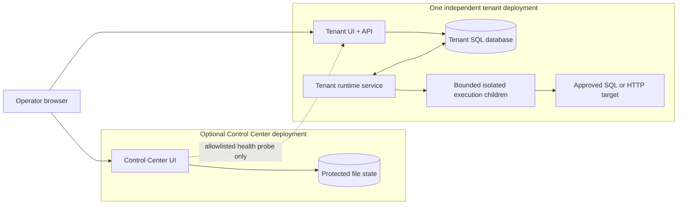

# Architecture

WorkerDock is a self-hosted job platform. Its deployment boundary is a tenant: each tenant has a web application, SQL Server database, and one Windows runtime service. The service launches bounded execution child processes. Tenants may share infrastructure, but shared Windows-host and SQL administrators remain trusted across tenants. The optional Control Center stores tenant directory and health observations in a protected file journal; it does not provision tenants, access their databases, or proxy their management sessions.

## Deployment map

The Control Center holds links and health results. A browser opens the tenant
directly, where that tenant's own sign-in and role policy apply. Durable work,
business records, and runtime status live inside the tenant database; the
execution child resolves secrets through that tenant's configured vault
identity.

## Components

- **Tenant web application (IIS):** serves the dashboard and management/read APIs, authentication, configuration, and audit transactions. It does not execute handlers.
- **Tenant runtime Windows service:** owns schedule materialization, execution dispatch, alert evaluation and delivery, metric aggregation, and retention. A tenant-scoped named mutex rejects a second runtime instance. Bounded polling reads durable work directly from SQL; a local semaphore enforces the child ceiling.
- **Execution child:** runs one pinned trusted template attempt in a separately contained process tree. The runtime owns the attempt lease, stop handling, result persistence, and uncertain-outcome review.
- **Execution child:** performs one attempt or diagnostic run, resolves configured secrets, and invokes a built-in or installed trusted template.
- **Control Center:** maintains its own file-backed registry and probes an allowlisted tenant health endpoint using a minimal health credential. The Control Center has no central SQL database, connection, or SQL identity requirement.
- **Tenant SQL preparation:** operators apply the `0001_initial` checksummed fresh-install baseline using `scripts/Invoke-TenantMigration.ps1`, or use `database/tenant/current-state.sql` for a fresh empty database. Runtime startup does not create schema. No tenant databases are deployed and no upgrade converter is provided. Live SQL parity remains unverified until SQL checks run against a configured test server.

Each tenant database contains WorkerDock-owned objects in `[workerdock]`. Job commands, schedules, queued executions, attempts, alert deliveries, runtime heartbeat, audit, and retention records are durable SQL state. The web app writes business commands and audit records; the runtime reads and updates those rows directly under bounded transactions. No broker or secondary work store is used.

## Scheduling and execution

WorkerDock commits business changes, audit records, and accepted queued work in SQL transactions. The runtime polls bounded pages and rechecks current job, schedule, and capacity state before claiming work. Schedule cursors and occurrence insertion share one transaction so repeating a sweep does not duplicate work.

The runtime claims executions from SQL and supervises each child until exit and outcome persistence. Attempt leases and generation fencing reject stale completions. Operators stop work through durable controls; service shutdown stops admission and drains children for the configured bounded period.

Delivery is at least once. A process crash or uncertain acknowledgement can lead to retry after external work has started. WorkerDock cannot guarantee exactly-once external effects. Retries depend on configured policy and idempotency; uncertain outcomes may require operator review. Scheduled occurrences and manual request retries have deduplication identities, but these do not make downstream side effects exactly once.

Schedules use five-field cron semantics and an explicit time zone. DST gaps and repeated local times follow the persisted WorkerDock policy. Missed-work behavior is configurable. See the schedule UI and the implementation's schedule policy tests for the exact deployed behavior; do not assume a third-party cron dialect without checking compatibility.

## Authentication and secrets

OIDC/Entra authentication is optional in configuration. When configured, readers need an authenticated session and management actions may additionally require the configured role. When OIDC settings are absent, **Anonymous mode allows both read and management access**; do not expose an instance in this mode to an untrusted network.

Connection profiles store nonsecret settings and credential references, not passwords or full connection strings. Secret values resolve at execution time through `ISecretVault`. The repository includes an environment-backed adapter for development; production vault adapters are not supplied and must be installed in the relevant service composition roots before secret-backed production work. The Control Center currently refuses Production startup without its adapter. Its health credential is not a tenant management credential. See [secret integration](secrets.md) and [deployment](../how-to/deploy-production.md).

## Capacity and limits

The design's initial validation target is up to 10 independent tenants, 100 configured jobs per tenant, and 10 concurrent executions per tenant. These are targets, not guaranteed capacity or fixed product ceilings. Actual throughput depends on job duration, process startup, SQL latency, and host resources. Publish measured results with hardware and workload details before making capacity claims.

Finite execution deadlines and configured service drain periods bound normal work, but an infinite-timeout handler can run indefinitely. External side effects may have occurred when a worker loses contact with a child. There is no strict global priority guarantee. Worker availability also depends on SQL Server; the central directory is not required for tenants to operate or be accessed directly.

## Observability and retention

WorkerDock records execution events, safe logs, audit records, runtime health, alerts, and bounded metric aggregates in SQL Server. Alerts and the Control Center cannot report through a prolonged database or network outage. Operators should also monitor the Windows runtime service, host health, SQL Server, clock synchronization, disk space, archive health, and installed template catalog independently.

Retention is bounded and preserves active work and replay dependencies. Archive-before-delete is opt-in; archives are integrity-checked exports, not database backups or proof against an administrator changing both archive and manifest. See [retention and archive operations](../how-to/manage-retention-and-archives.md).
