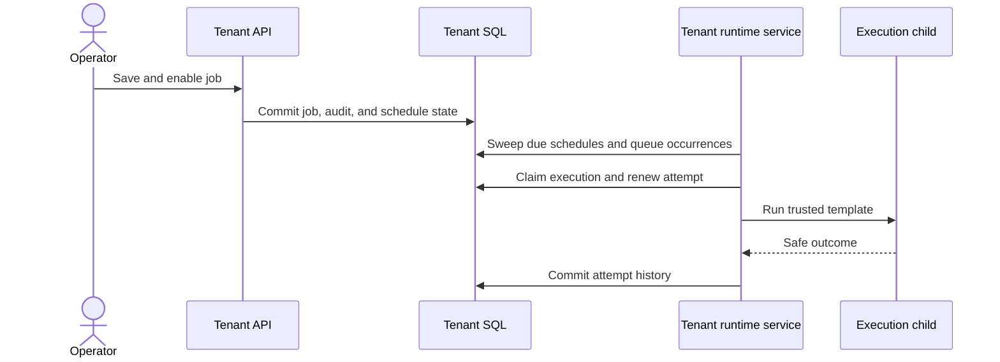

# Durable schedules and lifecycle

## Job flow

Schedules, accepted executions, attempts, and audit use SQL tables in the same
tenant database. A manual run creates its queued execution in the API
transaction. The tenant runtime polls bounded SQL pages for schedules,
executions, and deliveries. An attempt may need operator review after an
uncertain failure. See [execution guarantees](execution-guarantees.md).

Schedules are tenant business records in `[workerdock].Schedules`. The runtime
scans due rows and calls `OccurrenceWriter`, which rechecks current revisions
and state before queuing an occurrence. Completed one-time schedules are
excluded from future scans.

`OccurrenceWriter` takes a SQL application lock per schedule, locks and rechecks the current schedule and job, and advances `CursorUtc` in the same transaction that inserts queued scheduled executions and calls job admission. Each execution stores its scheduled UTC instant and the job/profile revisions accepted at materialization. Its idempotency key is derived from schedule ID, schedule revision, and occurrence instant. Queued executions are the durable dispatch source; the runtime claims them directly and attempt leases fence duplicate claims. Accepted executions survive later schedule edits or removal, while the admission/start path still checks current disable, archive, stop, and concurrency limits.

Each materialization enumerates at most 100 evaluator candidates and produces
at most 100 executions. When more are due, the cursor advances only through the
bounded page and a later runtime poll continues the scan. Lateness is
classified per occurrence: `Skip` omits occurrences older than tolerance;
`Coalesce` emits one latest missed occurrence after a complete bounded scan;
`CatchUp` accepts occurrences inside the age window and configured count bound.
A CatchUp outage pins its original horizon and cumulative execution budget in
SQL across pages. Cursor, budget, queued executions, and recovery counts commit
together.

Cron definitions retain their IANA zone. The evaluator is authoritative for DST
gaps, overlaps, and preview UTC instants; a one-time editor value is local
`DateTimeKind.Unspecified`, with an explicit selected offset required for an
ambiguous instant. A bounded runtime scan compares saved zone-rule fingerprints
with deployed rules. A change advances the schedule revision and job ETag,
records a system audit, and affects only future occurrences. Existing accepted
UTC occurrences are never rewritten.

Enable validates the current saved job revision, template configuration,
profile availability, execution policy, and optional schedule under the job
lock, then updates enabled state, activation boundary, audit, and command
receipt transactionally. `EnableManual` rejects any saved schedule. Pause
suppresses future sweeps; resume resets the cursor to the resume instant, so the
paused interval is not replayed. Disable and Archive close the business start
gate. Archive tombstones the schedule; deleting a schedule leaves a manual job.
These controls do not cancel accepted or running work. Retry operates on its
accepted execution and never re-enters missed-occurrence policy.

The delay from the scheduled UTC instant to execution start is the schedule
delay metric. Durable lifecycle state and occurrence acceptance are SQL Server
owned. The `0001_initial` baseline creates the schedule tables; fresh-install
instructions are in [Set up SQL Server](../how-to/setup-sql-server.md).

## Operator editor

The tenant UI stores the local date/time, selected zone, and explicitly chosen UTC offset separately. Switching between English and Brazilian Portuguese changes labels only; it does not reinterpret the selected instant. The preview endpoint is authoritative and returns UTC ISO instants with their display offsets. Editors show the five-field cron grammar and AND semantics for day-of-month and day-of-week. The time-zone list is served by the tenant API for read access; schedule preview and mutation require management access.

Schedules are saved while the job is disabled. The operator reviews the
resulting draft and then enables it with the current ETag; failed schedule saves
leave the job disabled and preserve its identity and form values. Stale ETags
keep edited values available for correction. Schedule changes commit directly
to SQL and are picked up by the runtime poll. Deleting a schedule requires
confirmation and leaves a manual job. Lifecycle actions are audited by the
server.
