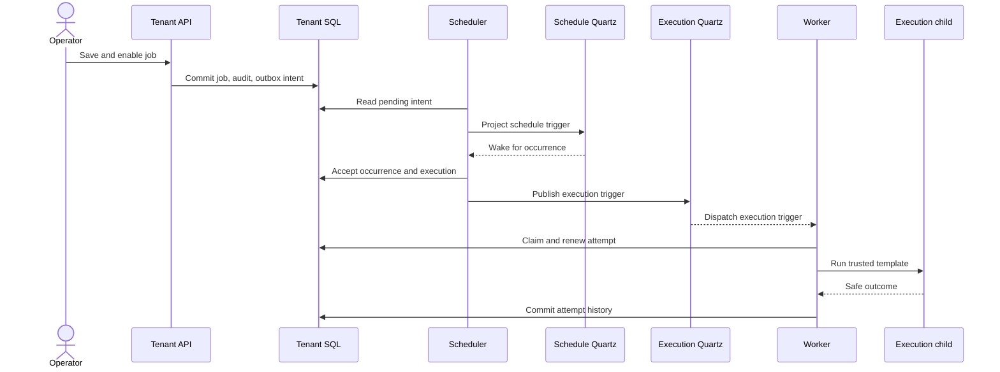

# Durable schedules and lifecycle

## Job flow

Both Quartz stores use SQL-backed tables in the same tenant database.
WorkerDock keeps job definitions, accepted executions and audit in its own
tables. A manual run starts at the API's execution-acceptance path without
the schedule wake. A delayed projection or lost acknowledgement is reconciled
from durable state, and an attempt may repeat after an uncertain failure. See
[execution guarantees](execution-guarantees.md).

Schedules are tenant business records in `[workerdock].Schedules`. Quartz is a projection target: a transactional `ScheduleProjection` outbox item is the only route that creates or removes a future trigger. The reconciler validates the envelope and rereads current business state before applying it, so delayed projections cannot revive an old revision. Quartz cron/simple trigger misfires wake `OccurrenceWriter`; Quartz does not decide which business occurrences are accepted.

`OccurrenceWriter` takes a SQL application lock per schedule, locks and rechecks the current schedule and job, and advances `CursorUtc` in the same transaction that inserts queued scheduled executions and calls job admission. Each execution stores its scheduled UTC instant and the job/profile revisions accepted at materialization. Its idempotency key is derived from schedule ID, schedule revision, and occurrence instant. Outbox delivery remains at least once; no exactly-once guarantee is made. Accepted executions survive later schedule edits or removal, while the admission/start path still checks current disable, archive, stop, and capacity controls.

Each materialization enumerates at most 100 evaluator candidates and produces at most 100 executions. When more are due, the cursor advances only through the bounded page and another Quartz wake continues the scan. Lateness is classified per occurrence: a `Skip` omits occurrences older than tolerance while accepting timely occurrences; `Coalesce` emits one latest missed occurrence after a complete bounded scan; `CatchUp` accepts occurrences inside the age window and configured count bound. A CatchUp outage pins its original horizon and cumulative execution budget in SQL across pages; each page atomically advances the cursor, budget, accepted executions, and recovery-event skipped count. Overflow and age-expired missed occurrences are recorded in `ScheduleRecoveryEvents.SkippedOccurrences`. `ScheduleRecoveryEvents.ExactMissedCount` is null whenever enumeration was bounded or the exact number was not computed. Occurrences inside the configured lateness tolerance are otherwise accepted normally.

Cron definitions retain their IANA zone. The evaluator is authoritative for DST gaps, overlaps, and preview UTC instants; a one-time editor value is local `DateTimeKind.Unspecified`, with an explicit selected offset required for an ambiguous instant. The stored `ZoneRulesFingerprint` records the timezone rules used when saving, and the Quartz policy calendar name includes the fingerprint. Bounded maintenance scans compare stored values with the injected deployed-rules provider. A change advances the schedule revision and job ETag, records a system audit, and writes a new projection outbox item; the next reconciliation replaces only future Quartz triggers/calendars. Existing accepted UTC occurrences are never rewritten.

Enable validates the current saved job revision, template configuration, profile availability, execution policy, and optional schedule under the job lock, then updates enabled state, activation boundary, audit, command receipt, and schedule projection intent transactionally. `EnableManual` additionally rejects any saved schedule. Pause removes future Quartz triggers and resume resets the cursor to the resume instant, so the paused interval is not replayed. Disable/Archive close the business start gate before projecting Quartz removal. Archive tombstones the schedule; deleting a schedule leaves a manual job. These controls do not cancel accepted or running work. Retry operates on its accepted execution and never re-enters missed-occurrence policy.

The delay from the scheduled UTC instant to execution start is the schedule delay metric; the time from occurrence materialization to Quartz projection is the projection delay metric. Durable lifecycle state and the acceptance path are SQL Server owned. Migration `0005_scheduling` introduced the schedule tables; current tenant installation and upgrade instructions are in [Set up SQL Server](how-to/setup-sql-server.md).

## Operator editor

The tenant UI stores the local date/time, selected zone, and explicitly chosen UTC offset separately. Switching between English and Brazilian Portuguese changes labels only; it does not reinterpret the selected instant. The preview endpoint is authoritative and returns UTC ISO instants with their display offsets. Editors show the five-field cron grammar and AND semantics for day-of-month and day-of-week. The time-zone list is served by the tenant API for read access; schedule preview and mutation require management access.

Schedules are saved while the job is disabled. The operator reviews the resulting draft and then enables it with the current ETag; failed schedule saves leave the job disabled and preserve its identity and form values. Stale ETags keep the edited values available for correction. Pending projection is shown as pending until effective scheduler state is confirmed. Deleting a schedule requires confirmation and leaves a manual job. Lifecycle actions are audited and applied by the server before Quartz projection.
